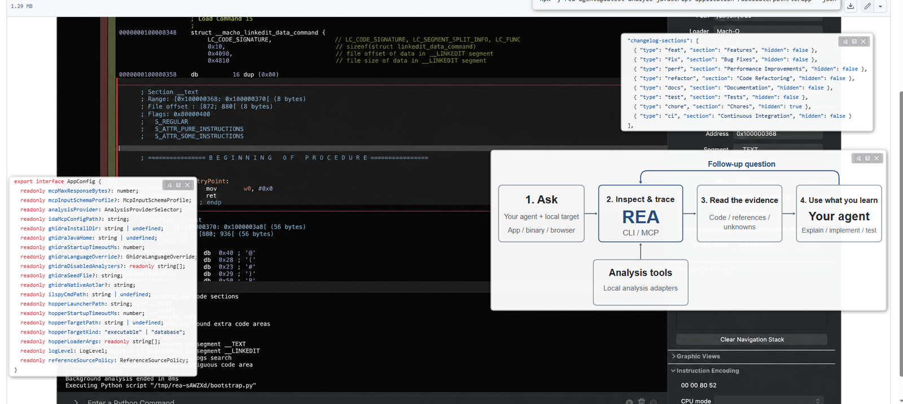
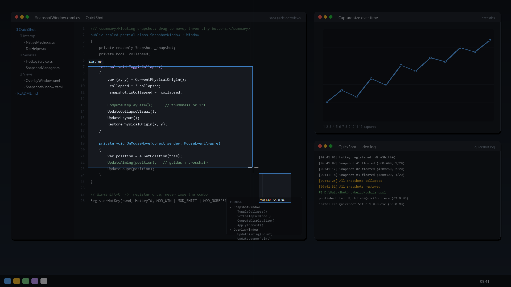
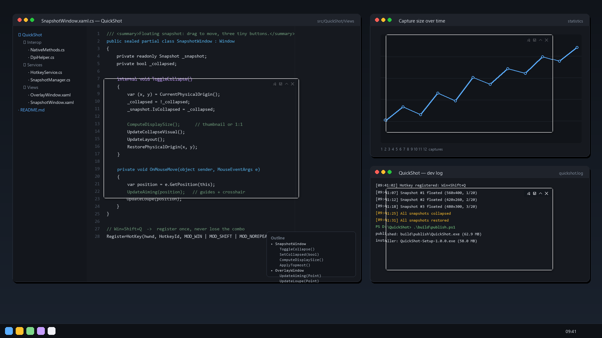
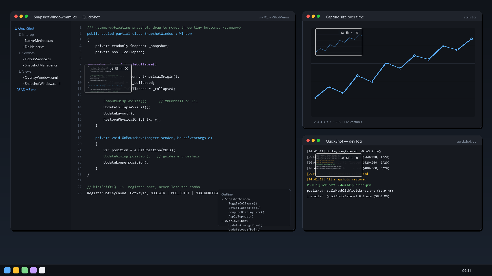
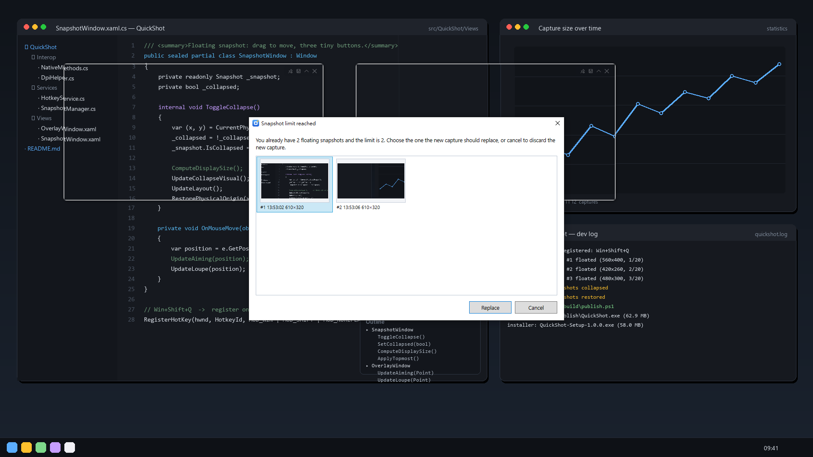
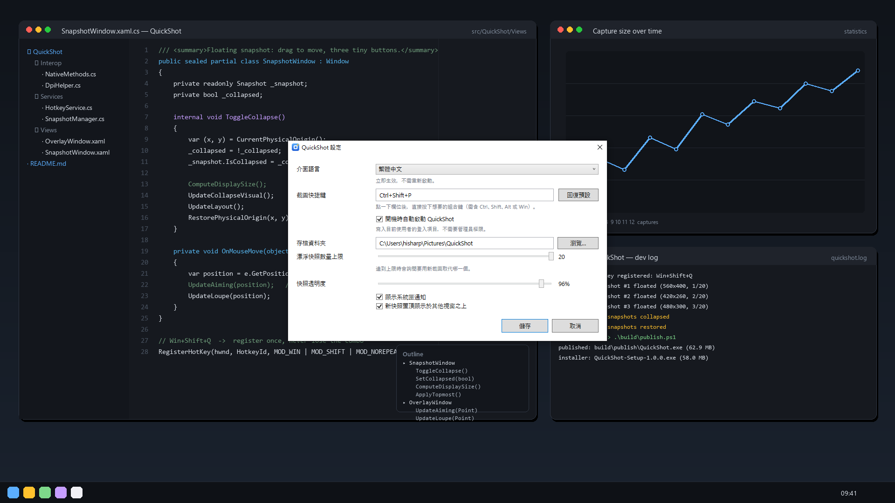

# QuickShot

<p>
  
</p>

**A tray-resident screenshot tool for Windows: press a global hotkey, drag a rectangle, and the
capture instantly floats on top of your desktop — movable, always-on-top if you want,
with three tiny buttons to pin, save or close it.**

**English** · [繁體中文](README.zh-TW.md)


---

## Screenshots
### A real session



Five regions captured from a documentation page, each one still floating where it was taken
from. This is what QuickShot is for: collect the pieces you need, keep them in view, save or
close them when you are done.

### Selecting a region



The desktop is frozen the instant the hotkey fires and dimmed, so the selection shows through
at full brightness. Full-screen guide lines and a two-tone crosshair show the exact pixel, the
small badge is the pointer position in physical pixels, and the magnifier reads out
`978, 667 — 472 × 399` while you drag. `Esc` or a right click cancels.

### Floating snapshots



Each snapshot floats exactly over the region it came from, with the three (four once you count
collapse) 18 × 18 px controls fading in on hover: 📌 always-on-top, 💾 save, ⌃ collapse,
✕ close. Drag the body to move it, double-click to toggle 1:1 / fit.

### Collapsed



Being resident means space matters, so every snapshot rolls up into a thumbnail of at most
180 × 135 px — still floating, still in place, and restored to exactly the previous size on
demand. The tray menu does all of them at once.

### Snapshot limit



Twenty floating snapshots are the default budget. When the limit is reached you are asked
which one the new capture should replace (the oldest is preselected), or you can cancel and
discard the new capture.

### Settings



Language, hotkey, start with Windows, save folder, snapshot limit, opacity and notifications.
Switching the language re-translates the whole UI immediately — no restart.

> The desktop behind these screenshots is a generated sample scene
> (`tools/screenshot-backdrop.py`), so nothing but the app itself is on display. The first
> screenshot is a real session.

---

## Install

| | |
|---|---|
| **Installer** (recommended) | download `QuickShot-Setup-1.0.1.exe` from [Releases](../../releases), run it — per-user install into `%LocalAppData%\Programs\QuickShot`, **no administrator rights**, Start Menu shortcut, uninstaller, and the "start with Windows" task ticked by default |
| **Portable** | download `QuickShot.exe` (self-contained, ~63 MB) and run it anywhere — no .NET runtime needed |
| **Framework-dependent** | `.\build\publish.ps1 -Framework` produces a 0.35 MB build that needs the .NET 8 Desktop Runtime and uses about half the memory |

Requirements: Windows 10 1809+ or Windows 11, x64, nothing else.

---

## Usage

| Action | How |
|---|---|
| Capture a region | `Win + Shift + Q` (changeable), tray double-click, or start `QuickShot.exe` again |
| Cancel a selection | `Esc` or right-click |
| Move a floating snapshot | drag the snapshot body |
| Zoom 1:1 / fit | double-click the snapshot body |
| Collapse to a thumbnail | the ⌃ button, or the right-click menu |
| Restore the original size | the ⌄ button, or the right-click menu |
| Collapse / restore **all** snapshots | tray menu → *Collapse all to thumbnails* / *Restore all snapshots* |
| Save | the 💾 button — left click saves to the default folder, right click is *Save as…* |
| Keep on top | the 📌 button, or the right-click menu |
| Close / close all | the ✕ button; tray menu → *Close all snapshots* |
| Settings | tray menu → *Settings…* |

Snapshots are written to `%USERPROFILE%\Pictures\QuickShot\QuickShot_<yyyyMMdd_HHmmss>.png`;
collisions get `_2`, `_3`, … appended.

### Command line flags

| Flag | Effect |
|---|---|
| *(none)* | start resident, or — if already running — ask the running instance for a new capture |
| `--capture` | open the selection overlay immediately |
| `--settings` | open the settings dialog (also forwarded to the running instance) |
| `--collapse` | collapse every snapshot into a thumbnail; run again to restore them |

Because a second launch forwards the request to the running instance, these flags double as a
scriptable trigger — bind `QuickShot.exe --collapse` to a keyboard shortcut or an AutoHotkey
script and you have "get all these snapshots out of my way" on one key.

---

## Technology


* **C# 12 / .NET 8 (LTS)**, WPF for the UI, WinForms only for the tray `NotifyIcon`
* **Zero NuGet dependencies** — the hotkey, capture and DPI work is P/Invoke on `user32`/`shcore`
* `RegisterHotKey` + a message-only `HwndSource` for the global hotkey (`WM_HOTKEY`)
* GDI `BitBlt` (`CopyFromScreen`) for capture, `PngBitmapEncoder` for lossless snapshots
* **PerMonitorV2** DPI awareness (`app.manifest`) so region coordinates are pixel-exact on
  mixed-DPI multi-monitor setups
* Inno Setup 6 installer, per-user, no elevation; self-contained single exe publish
* English (default) + Traditional Chinese, switched at runtime through a XAML resource
  dictionary and a `{res:Loc Key}` markup extension

---

## Settings

Stored in `%AppData%\QuickShot\settings.json`; a log lands next to it as `quickshot.log`.

| Key | Default | Meaning |
|---|---|---|
| `AutoStart` | `true` | Write the per-user `Run` entry (`HKCU\...\CurrentVersion\Run`) |
| `Language` | `"en"` | `"en"` or `"zh-TW"` |
| `Hotkey` | `"Win+Shift+Q"` | any `Ctrl/Shift/Alt/Win + key` combination |
| `SaveFolder` | `…\Pictures\QuickShot` | where snapshots are written |
| `MaxSnapshots` | `20` | floating snapshot limit |
| `SnapshotOpacity` | `0.96` | 0.30 – 1.00 |
| `PinNewSnapshots` | `true` | new snapshots start always-on-top |
| `Notifications` | `true` | tray balloon notifications |

---

## Build from source

```powershell
# debug build + run
dotnet build src\QuickShot\QuickShot.csproj -c Debug
src\QuickShot\bin\Debug\net8.0-windows\QuickShot.exe

# self-contained single exe  ->  build\publish\QuickShot.exe            (62.9 MB)
.\build\publish.ps1 -SkipInstaller

# single exe + installer      ->  build\installer\QuickShot-Setup-1.0.1.exe  (58 MB)
.\build\publish.ps1

# tiny framework-dependent build -> build\publish-framework\            (0.35 MB)
.\build\publish.ps1 -Framework -SkipInstaller
```

Requires the .NET 8 SDK and (for the installer step) Inno Setup 6.

Inno Setup bundled the unofficial translations up to 6.4; 6.5 and later do not. So on a
newer Inno Setup the installer is English-only unless `Languages\ChineseTrad.isl` is present —
`build\publish.ps1` looks for it and offers the Traditional Chinese installer UI when it can
(the app itself is bilingual either way).

### Project layout

```
src/QuickShot
├─ App.xaml(.cs)              single instance (mutex + named events), capture flow, settings
├─ Interop/                   RegisterHotKey / GDI / DPI / SetWindowPos P/Invoke
├─ Models/                    AppSettings, Snapshot, HotkeyGesture (parse + display)
├─ Services/                  HotkeyService, TrayService, ScreenCaptureService,
│                             SnapshotManager, SettingsService, LocalizationService, Log
├─ Views/                     OverlayWindow + SelectionSession, SnapshotWindow,
│                             ReplaceSnapshotDialog, SettingsWindow
├─ Resources/                 Strings_en.xaml, Strings_zh-TW.xaml, Loc markup extension
└─ Themes/Styles.xaml         brushes + tiny button styles
installer/QuickShot.iss       Inno Setup script
build/publish.ps1             publish + package
tools/                        icon generator, screenshot backdrop, e2e test scripts
```

### Three decisions worth knowing

1. **Capture first, then overlay.** The whole virtual desktop is grabbed the instant the hotkey
   fires; the dimmed selection overlay then draws that frozen frame. This removes the
   "hide the overlay → wait → capture → restore" race, which is why the overlay can never end up
   in the snapshot, why the magnifier works, and why there is no flicker.
2. **One overlay window per monitor.** A single window spanning monitors with different DPI
   scales is laid out in one DPI space, which makes region coordinates drift. Per-monitor
   windows plus a physical-pixel conversion measured from `GetWindowRect` are exact.
3. **Snapshots are stored as PNG bytes, not bitmaps.** 20 full-screen 4K bitmaps would be
   ~660 MB. Each snapshot keeps its lossless PNG plus a preview of at most 1600 px instead, so
   20 snapshots stay around 150 MB in total. Saving writes the original PNG bytes directly (no
   re-encode, no quality loss); 1:1 zoom decodes the full image on demand and releases it again.

---

## Verified behaviour

Automated end-to-end runs drive the real window with synthetic keyboard and mouse input, and
check the results pixel-wise (`tools/e2e/`):

| What | Result |
|---|---|
| Hotkey `Ctrl+Shift+P` → overlay → drag → float | `Snapshot #1 floated (560×400, 1/20)` |
| Shipped default hotkey `Win+Shift+Q` | `Snapshot #1 floated (560×300, 1/20)` |
| Pixel accuracy | the selected 560×400 and 560×300 regions matched the drag exactly |
| Snapshot lands precisely over the captured area | confirmed by screenshot diff |
| Tiny toolbar (pin / save / collapse / close) | confirmed by 8× zoom of the screen grab |
| Save button → file on disk | `QuickShot_20261019_115155.png` (52,990 bytes) |
| Limit: 3 captures with `MaxSnapshots=2` | `#1 (1/2)`, `#2 (2/2)`, dialog, then `#3 (2/2)` |
| Collapse all → restore all (rects measured with `EnumWindows`) | `580×320, 420×420` → `200×116, 155×155` → back to `580×320, 420×420`, positions unchanged |
| Per-window collapse button | only the clicked window shrank; the other stayed `420×420` |
| Extreme aspect ratios when collapsed | `700×50` → `200×92`, `80×400` → `128×155`, letterboxed not stretched |
| Aiming aids | crosshair, guides and the `x, y` read-out matched the real cursor pixel |
| Settings dialog in `en` and `zh-TW` | all labels localised, all bindings resolved |
| Memory over 8 consecutive snapshots | 80 MB idle → 139 MB, oscillating 143–159 MB (plateau, no leak) |

| Build | on disk | idle working set | after snapshots |
|---|---|---|---|
| `-Framework` (needs .NET 8 Desktop Runtime) | 0.35 MB | 80 MB | ~150 MB, stable |
| default (self-contained single exe) | 62.9 MB | 206 MB | ~250 MB, stable |

---

## Known limitations

* **Exclusive-fullscreen games**: nothing can float on top of them; borderless windowed mode works.
* **DRM content** (Netflix, Disney+, …) captures as a black frame — an OS restriction.
* **Hotkeys are exclusive**: while QuickShot runs, the registered combination is taken from
  every other app. `Win+Shift+Q` is verified free on Windows 10; a combination another program
  already owns cannot be registered, and QuickShot reports the conflict instead of failing
  silently. `Win+Shift+↓` **cannot** be used — Windows reserves it (verified:
  `RegisterHotKey` returns `ERROR_HOTKEY_ALREADY_REGISTERED`), nor can `Win+↓`,
  `Win+Shift+S` or `Win+L`.
* Snapshot windows stay out of Alt+Tab on purpose (`WS_EX_TOOLWINDOW`).
* One region per drag: a selection cannot span two monitors with different DPI scales.

---

## Development reference material

Everything used to build, package and verify the app lives in the repo:

| Path | What it is |
|---|---|
| `tools/make-icon.py` | the logo generator: `--sheet` renders an A–D candidate contact sheet (used to pick the final mark), `--design B` writes `logo-*.png` + a 7-frame `quickshot.ico` with per-size optical scaling |
| `docs/design/icon-candidates.png` | the original icon candidate sheet, for reference |
| `tools/screenshot-backdrop.py` | generates the synthetic desktop used for the README screenshots |
| `tools/e2e/verify.ps1` | **the verification suite**: builds, drives the real app and asserts every row of the *Verified behaviour* table (capture, pixel accuracy, save, limit, collapse/restore, extreme aspect ratio, memory). Exits non-zero on failure. |
| `tools/e2e/screenshots.ps1` | regenerates every README screenshot by driving the app |
| `tools/e2e/hotkey-probe.ps1` | asks Windows which hotkey combinations are actually available (`RegisterHotKey` availability table) |
| `%AppData%\QuickShot\quickshot.log` | runtime log (INFO/DEBUG lines) |

---

## License

[MIT](LICENSE) © Caron Yang

QuickShot is not affiliated with any other screenshot tool. "Windows" is a trademark of
Microsoft Corporation.
